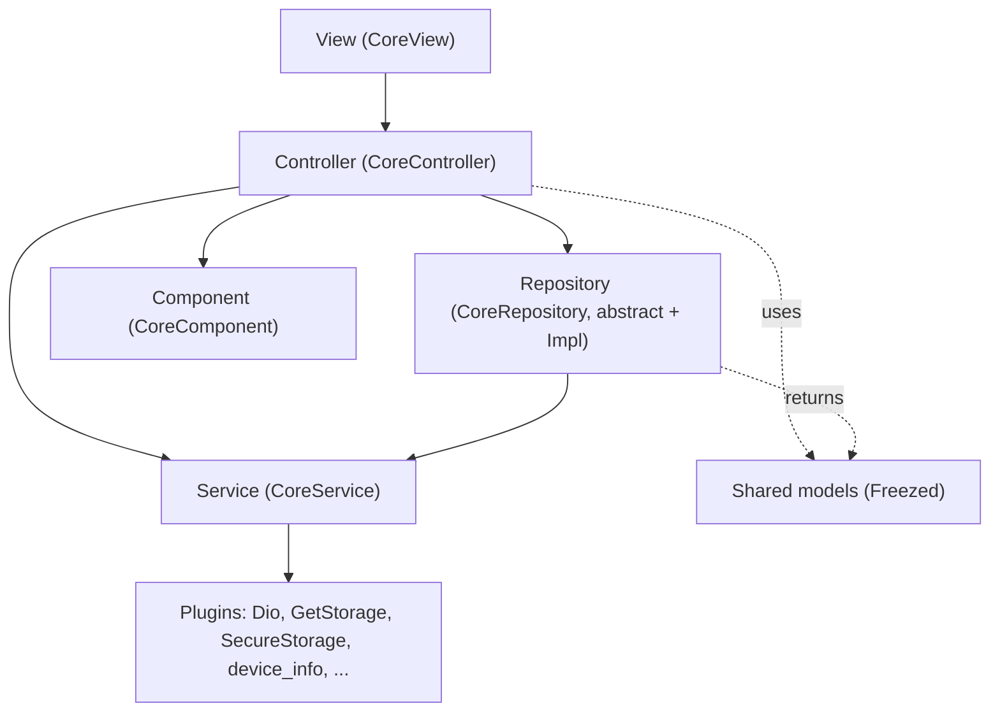
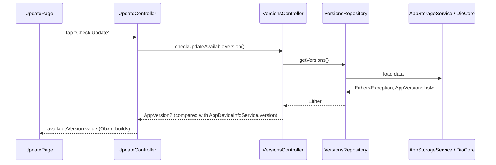
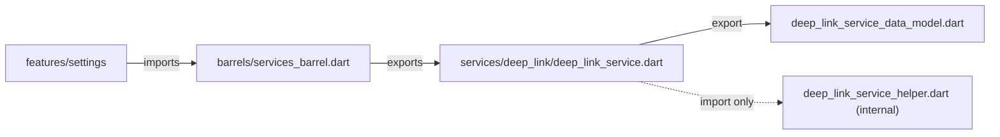

# Architecture

## Layers

The app is MVVM with GetX. Each layer depends only on the layers below it.

| Layer | Base class | Lifetime | Role |
|---|---|---|---|
| View | `CoreView<C>` | Per page | Layout only. Reads `controller`, wraps reactive parts in `Obx` |
| Controller | `CoreController` | Lazy, recreated (`fenix`) | Page state and actions. Hooks: `dataInit`, `pageInit`, `onInitFunction`, `onReadyFunction`, `onCloseFunction` |
| Repository | `CoreRepository` / `CoreRepositoryImpl` | Lazy, recreated | Data access for a feature. Abstract type plus `Impl`, resolved through the abstract |
| Service | `CoreService` (`GetxService`) | Permanent singleton | Owns a plugin or system concern (network, storage, logging, …) |
| Component | `CoreComponent` | Lazy, recreated | Small helpers with no long-lived state (share, permissions, file dialogs, …) |
| Model | Freezed class | Value | Typed data. Shared models live in `lib/shared/shared_models` |

`lib/core/core_elements/core_use_case.dart` also defines `UseCaseNoParams` and `UseCaseWithParams` for features that need a use-case layer between controller and repository.

## Dependency injection and routing

Classes are registered by annotation. Running `build_runner` generates `lib/main.get_put.dart`:

| Annotation | Generated registration |
|---|---|
| `@GetPut.page()` | A `GetPage` with route `/<ClassName>` |
| `@GetPut.controller()` | `Get.lazyPut<C>(..., fenix: true)` |
| `@GetPut.component()` | `Get.lazyPut<C>(..., fenix: true)` |
| `@GetPut.repository(as: Abstract)` | `Get.lazyPut<Abstract>(() => Impl(), fenix: true)` |
| `@GetPut.service()` / `@GetPut.service(as: Abstract)` | `Get.putAsync<T>(...)` |

Callers always resolve the **abstract** type (`VersionsRepository.to`, `SecureStorageService.to`), never the `Impl`. Each type exposes a static `to => Get.find()`.

Page metadata (name, route, icon, bottom bar index, drawer presence) lives in `AppPages` (`core_resources/page_details.dart`). Navigate with `goToPage(AppPages.settings)`, which also counts page opens.

## Startup

`lib/main.dart`:

1. `runZonedGuarded` catches uncaught errors
2. `WidgetsFlutterBinding.ensureInitialized()`
3. `GetPutBindings().dependencies()` registers everything
4. `EnvironmentHandler.applyEnvConfig()`
5. `GetStorage.init()` and `GetSecureStorage.init(password: EnvConfig.secureStoragePassword, …)`
6. `runApp(MainApp)`. `GetMaterialApp` uses the generated pages, theme, and localization delegates

The initial route is the Splash page. It records the launch and moves to Home.

## Results and errors

Async operations return `Either` instead of throwing (`core_resources/defined_types.dart`):

| Type | Left side |
|---|---|
| `BaseResponse<T>` | `GeneralException` |
| `BaseAPIResponse<T>` | `NetworkException` |
| `BaseLocalResponse<T>` | `LocalException` |

Exceptions are in `lib/components/failure/`. `NetworkException.handleResponse` and `LocalException.handleResponse` map plugin errors to these types, and return them rather than throw.

## Data flow example

Checking for an update:

## Network

- One Dio instance: `DioCore.to.client`. Base URL comes from `EnvConfig.apiBaseUrl`
- Interceptor order: `AuthInterceptor` adds the Bearer token unless the request sets `skipAuth`, `RetryInterceptor` retries GET/HEAD on timeouts and 502–504, then `LoggingInterceptor` logs in debug only
- Endpoints are centralized in `AppAPIUrls` (`core_resources/apis.dart`)
- `callMethod` and `download` return `BaseAPIResponse<T>` and count API calls

## Storage

- `AppStorageService` stores the whole `AppData` model (versions, settings, statistics) under `AppStorageKeys.appData`
- The engine is chosen by `CoreDefaults.defaultStorageProvider` (GetStorage or SharedPreferences). Both implement `AppStoragesAbstraction` and are injected into the service, which makes them easy to mock
- `AppDataRepository` (shared) is the preferred way for features to read and write `AppData`
- `SecureStorageService` holds tokens and deep-link payloads under `AppStorageKeys`

## Configuration

| Concern | Source |
|---|---|
| Environment name | `AppInfo.environment` |
| Environment settings | `config/envs/*.json` → `EnvironmentVariables.current` → `EnvConfig` |
| Feature flags | `CoreFlags` (`isRelease`, `checkUpdate`, `clearData`) |
| Defaults | `CoreDefaults`, `AppDefaults`, `AppPaddings`, `AppTexts` |
| Branding and version | `AppInfo`, `AppDeveloperInfo` |
| User-visible text | `lib/localization/translation.i69n.yaml` → `Texts.to.<section>.<key>` |

## Barrels and the import rule

Every module is consumed through a generated barrel in `lib/barrels/`. The analyzer plugin `packages/barrel_import_lints` reports any other cross-module import as an **error**.

- `config/barrels.yaml` lists barrel outputs, their root folders, and `exclude` entries
- A module's main file (the annotated type) `export`s the siblings callers need. Those siblings are excluded from the barrel, so only the main file is listed, but importing the barrel still exposes them
- Internal-only files (helpers, interceptors, storage engines) are excluded and **not** exported
- `package:` imports are allowed only inside the module that owns the dependency. Others get it through that barrel's `package_exports`
- Features have no barrel. Files inside one feature import each other relatively. Cross-feature imports are not allowed; move shared code to a service, component, or `shared/`

